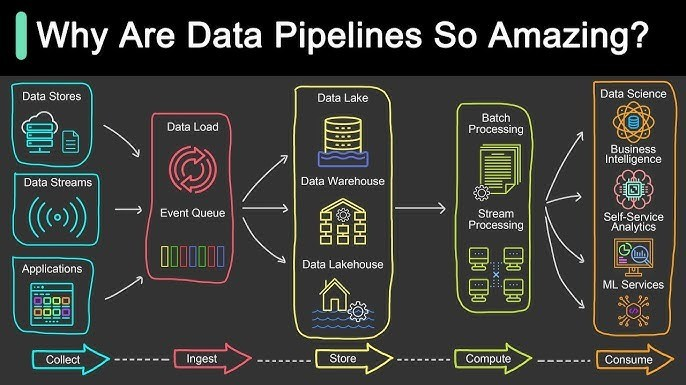

<link rel="stylesheet" href="my-theme.css">

**ゲーム分析応用/戦術・戦略プレゼンテーション** 
# データパイプライン
2026.10.18

---

# 本日の内容
- 前回の振り返り{.fragment .fade-left}
- Sec1 データパイプラインについて {.fragment .fade-left}
- Sec2 イメージを掴む {.fragment .fade-left}
- Sec3 設計してみよう {.fragment .fade-left}

---

# 前回の振り返り
- 後期演習①では各自データセットを用意して分析を行なった {.fragment .fade-left}
- 分析のサイクルは通常以下のように行われる {.fragment .fade-left}
	- 課題設定 {.fragment .fade-left}
	- データ収集 {.fragment .fade-left}
	- 整形（データ前処理） {.fragment .fade-left}
	- 分析・可視化 {.fragment .fade-left}
	- 伝達 {.fragment .fade-left}
- ただし、分析は通常一度では終わらない {.fragment .fade-left}
- 継続的な分析を行う上で、手作業はヒューマンエラー、負担につながる {.fragment .fade-left}
- 実務を想定すると以下にこれらの処理を自動化できるかが勝負 {.fragment .fade-left}
- 後期演習②ではこの中のプロセスを自動化することを目指す {.fragment .fade-left}

---

# Section1 データパイプラインについて
- 1-1 データパイプラインとは
- 1-2 なぜデータパイプラインが必要なのか
- 1-3 データパイプラインの全体像

---

## 1-1 データパイプラインとは
> あるシステムから別のシステムへデータを流す方法のこと。特定の順序で実行される一連のステップで構成され、あるステップの出力が次のステップの入力として機能する。 {.fragment .fade-left}

出典： databricks [データパイプラインとは何ですか？] {.fragment .fade-left} 

---

出典: Solon Das, [15 Real-World Data Pipeline Issues and How to Solve Them Like a Pro](https://jp.linkedin.com/pulse/15-real-world-data-pipeline-issues-how-solve-them-like-solon-das-pc7qc?tl=ja)（LinkedIn, 2025.4.17）

---

## 1-2 なぜデータパイプラインが必要なのか
- 先述の通り現場での分析は一度で完結しない（講義・研究を除く） {.fragment .fade-left}
- 手動で何度も同じ処理を行うのは非効率かつミスの温床 {.fragment .fade-left}
- データパイプラインで自動化ができれば質を担保しつつその業務から開放される！ {.fragment .fade-left}
- 一方で、ぶっちゃけ必要ではないし構築できる現職アナリストは少ない {.fragment .fade-left}

---

### [ちょっと脱線] 凡人は量で勝負！
- 自分が凡人だと思う人は量で勝負しよう！ {.fragment .fade-left}
- ただ残念なことに、いわゆる才能ある人たちは結構量もこなす {.fragment .fade-left}
- 我々に与えられている時間は平等に24時間。 {.fragment .fade-left}
- では、どのようにすれば勝てる…？ {.fragment .fade-left}
- 仕組みで時間を生み出し、空いた時間を考えることに使う！ {.fragment .fade-left}

---

## 1-3 データパイプラインの概要
- 大まかなプロセス（工程）は以下の通り {.fragment .fade-left}
	1. 収集 {.fragment .fade-left}
	2. 整形 {.fragment .fade-left}
	3. 保存 {.fragment .fade-left}
	4. 分析・可視化 {.fragment .fade-left}
- 前回の振り返りで紹介した「分析サイクル」とは少し違う…？ {.fragment .fade-left}

---

### 分析サイクルとパイプラインの対応
 

| 分析サイクル | パイプライン | 対応 |
| --- | --- | --- |
| 課題設定 | 前提 | 目的は人が決める |
| 収集 | 収集 | 同じ |
| 整形 | 整形 | 同じ |
| — | **保存** | **新規** |
| 分析・可視化 | 分析・可視化 | 同じ |
| 伝達 | 出口 | 誰に・いつ届けるか |

 

- 単発の分析では、データを「貯めておく」必要がなかった {.fragment .fade-left}
- 継続的に回すからこそ、前回までのデータを蓄積する「保存」が加わる {.fragment .fade-left}

---

### プロセスをつなぐ
- 各プロセスを自動化の処理でつなぐことで、一気に成果物まで生成される {.fragment .fade-left}
- ただ、まずは**一つのプロセスを自動で行えるところ**までを目指そう {.fragment .fade-left}

---

出典: Solon Das, [15 Real-World Data Pipeline Issues and How to Solve Them Like a Pro](https://jp.linkedin.com/pulse/15-real-world-data-pipeline-issues-how-solve-them-like-solon-das-pc7qc?tl=ja)（LinkedIn, 2025.4.17）

---

# Section2 イメージを掴む
- 2-1 実例の紹介	
- 2-2 各種ツールの調査

---

## 実は身近にあるデータパイプラインっぽいツール
Question: 身近にあるツールで思いつくものは？ {.fragment .fade-left}

---

## 2-1 実例の紹介
- Sportscode {.fragment .fade-left}
- エクセル・スプレッドシート {.fragment .fade-left}

---

## 2-2 各種ツールの調査
- ある特定のパートあるいは複数をカバーするツールを探してみよう
- この世にはある特定の工程のみに特化したツールが多く存在している
- どんなものがあるかみんなで調べてみよう

---

### Task1
いろんなツールを調査してみよう

Slidoで調査結果のシェア

---

# Section3 設計してみよう
- 3-1 プロセスの図式化
- 3-2 ツールの選定
- 3-3 後期演習②について

---

## 3-1 プロセスの図式化
- 最初の一歩は対象の業務フローがどのようになっているか理解すること
- 理解を深めるためにいろいろな方法があるが、今日はフローチャートを試してみよう
- フローチャートのような図も実は統一された記法が存在する
- 詳しくはUMLで検索してみよう（エンジニア以外も）

---

### Task2
簡易版フローチャートを書いてみよう

---

## 3-2 ツールの選定
- プロセスの中から自動化できそうな箇所を見つけよう
- 自動化したい場所が決まったらその要件にあうツールを探す
- ツールは複数の候補があることが一般的であるが、要件にあうものを決める

---

### Task3
自動化するツールを選定してみよう

---

## 3-3 後期演習②について
- 後期演習②ではパイプラインの一工程の構築を行います
- 題材は後期演習②で扱ったものでも、新しいテーマでも可です
- 発表は成果物のデモンストレーションとどのように構築したか（技術仕様）について行います
